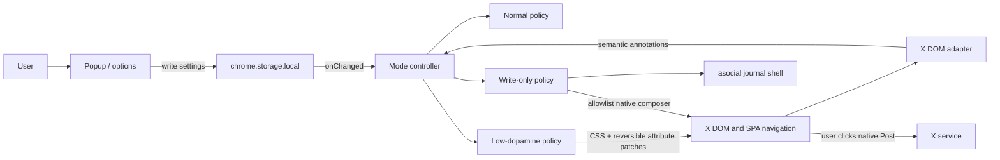

# asocial Extension Architecture

**Status:** Proposed
**Scope:** Private Chrome MVP with a cross-browser path
**Last updated:** 2026-08-13

## 1. Decision summary

Build asocial as a Manifest V3 WebExtension that reshapes X's existing website. Do not build an X client and do not call X APIs.

Use:

- current stable TypeScript in strict mode;
- WXT as the extension framework and Vite integration;
- React only for the popup and options/onboarding UI;
- framework-free TypeScript and CSS in the content-script path;
- pnpm with an exact `packageManager` version and committed lockfile;
- a deliberately sparse pnpm workspace and Turborepo root;
- Chrome local extension storage;
- Vitest for pure behavior/adapter contracts and browser smoke checks for the actual extension.

Do not add:

- a backend;
- X API credentials;
- a background service worker until a concrete feature requires one;
- a state-management library;
- remotely hosted code;
- invented shared packages with one consumer.

The central architectural boundary is an **X DOM adapter**. Modes consume semantic surface annotations produced by that adapter; they do not contain scattered X selectors.

## 2. Why a browser extension

The required behavior is presentation control over an authenticated website:

- hide or quiet selected X surfaces;
- preserve X's own composer and action controls;
- react to X's client-side navigation;
- keep authentication and posting inside X;
- restore the original page immediately.

A content script is the smallest mechanism that can do this. Chrome statically declared CSS is injected before DOM construction/rendering, and a `document_start` content script can apply mode state while the document is still loading. Extension contexts can use `chrome.storage` to persist and observe settings.

This architecture does not bypass X authentication, scrape content, or recreate X data. It changes what the user sees in their own browser. That is technically feasible; public distribution still requires a fresh review of X terms and browser-store policy.

## 3. Stack decisions

### 3.1 WXT over hand-rolled Vite entries

WXT is built for WebExtensions, uses Vite, supports TypeScript, generates manifests from entrypoints, and targets Chrome, Firefox, Edge, and Safari from one codebase. It removes custom build plumbing for popup pages, content scripts, CSS, manifests, development reload, and packaged artifacts.

A custom Vite multi-entry build is possible, but it would make asocial own manifest generation and extension-specific dev/release behavior without product benefit. CRXJS is also viable; WXT's cross-browser target and file-based entrypoints fit the planned Safari path better.

Use explicit imports. Do not lean on optional auto-import magic where a normal TypeScript import is clearer.

### 3.2 React only where there is application UI

The popup and options/onboarding page share accessible form controls, settings validation, and live state. React is justified there.

The content script is latency- and mutation-sensitive. It should use DOM APIs, a small controller, and static CSS directly. Mount only asocial's small journal shell in a Shadow Root; do not mount React over X or represent X content in React state.

### 3.3 pnpm workspace and Turborepo

The user requested pnpm workspaces and Turborepo. Keep them, but acknowledge the tradeoff: with one application package, Turbo gives no material performance benefit.

The initial workspace contains only `apps/extension`. Add a package only when a second real consumer exists. Likely future consumers are a public website, a reusable browser-agnostic behavior package, or a separately built Safari host—not hypothetical “shared,” “ui,” and “config” packages.

Use current stable package versions once during scaffolding, then commit exact tool versions and `pnpm-lock.yaml`. “Latest” is a bootstrap policy, not a runtime dependency range.

## 4. Repository shape

```text
asocial/
├── apps/
│   └── extension/
│       ├── entrypoints/
│       │   ├── content.ts
│       │   ├── popup/
│       │   │   ├── index.html
│       │   │   └── main.tsx
│       │   └── options/
│       │       ├── index.html
│       │       └── main.tsx
│       ├── src/
│       │   ├── settings/
│       │   │   ├── model.ts
│       │   │   ├── normalize.ts
│       │   │   └── repository.ts
│       │   ├── runtime/
│       │   │   ├── bootstrap.ts
│       │   │   ├── mode-controller.ts
│       │   │   ├── mutation-batcher.ts
│       │   │   └── patch-ledger.ts
│       │   ├── modes/
│       │   │   ├── low-dopamine.ts
│       │   │   ├── normal.ts
│       │   │   └── write-only.ts
│       │   ├── x-adapter/
│       │   │   ├── adapter.ts
│       │   │   ├── ownership.ts
│       │   │   ├── routes.ts
│       │   │   ├── rules.ts
│       │   │   └── surfaces.ts
│       │   ├── journal-shell/
│       │   │   ├── mount.ts
│       │   │   └── styles.css
│       │   └── ui/
│       │       ├── mode-picker.tsx
│       │       └── settings-form.tsx
│       ├── styles/
│       │   ├── bootstrap.css
│       │   ├── low-dopamine.css
│       │   └── write-only.css
│       ├── tests/
│       │   ├── fixtures/
│       │   ├── adapter.test.ts
│       │   ├── mode-controller.test.ts
│       │   └── settings.test.ts
│       ├── package.json
│       ├── tsconfig.json
│       └── wxt.config.ts
├── docs/
│   ├── ARCHITECTURE.md
│   └── PRD.md
├── package.json
├── pnpm-lock.yaml
├── pnpm-workspace.yaml
└── turbo.json
```

This is a target layout, not a requirement to create empty files or packages before implementation.

## 5. Runtime context



There is no asocial server in this flow. The extension never receives X credentials and never constructs a post request.

## 6. Manifest and permissions

Baseline Manifest V3 capabilities:

```json
{
  "permissions": ["storage"],
  "content_scripts": [
    {
      "matches": ["https://x.com/*", "https://twitter.com/*"],
      "run_at": "document_start",
      "world": "ISOLATED",
      "css": ["bootstrap.css"],
      "js": ["content.js"]
    }
  ],
  "action": { "default_popup": "popup.html" },
  "options_ui": { "page": "options.html", "open_in_tab": true }
}
```

WXT generates the final manifest; the snippet documents intent.

Do not request these in MVP:

- `cookies`;
- `webRequest` or `declarativeNetRequest`;
- `notifications`;
- broad `tabs` access;
- `scripting` for dynamic arbitrary-site injection;
- `<all_urls>`;
- externally connectable messaging.

If popup-to-tab diagnostics need `activeTab`, first prove the existing X host grant and normal tab messaging are insufficient. Permissions must follow implemented behavior, not anticipated behavior.

## 7. Settings model

Keep one versioned object and normalize every read from storage.

```ts
type Mode = "normal" | "low-dopamine" | "write-only";
type Visibility = "normal" | "quiet" | "hidden";

type SettingsV1 = {
  schemaVersion: 1;
  mode: Mode;
  confirmedHandles: string[];
  lowDopamine: {
    metricScope: "self" | "all";
    notifications: Visibility;
    messages: Visibility;
    mentionsShortcut: "shown" | "hidden";
    trendsAndRecommendations: "shown" | "hidden";
    premiumAndAnalytics: "shown" | "hidden";
  };
};
```

Defaults:

```ts
const defaults: SettingsV1 = {
  schemaVersion: 1,
  mode: "normal",
  confirmedHandles: [],
  lowDopamine: {
    metricScope: "self",
    notifications: "quiet",
    messages: "quiet",
    mentionsShortcut: "shown",
    trendsAndRecommendations: "hidden",
    premiumAndAnalytics: "hidden",
  },
};
```

Normalization rules:

- Treat storage as `unknown`; validate enum values and object shapes.
- Normalize handles by trimming whitespace, removing one leading `@`, and lowercasing for comparison.
- Deduplicate handles and reject empty/invalid path segments.
- Do not throw on an older or damaged settings object.
- If low-dopamine is selected with no confirmed handles, resolve the effective metric scope to `all`; do not silently rewrite the user's saved preference.
- Keep migrations pure and covered by fixture tests.
- Store the object in `chrome.storage.local`, not X page storage or Chrome sync.

## 8. Startup and no-flash strategy

The restrictive modes fail if X paints a feed or metric before hiding it. Startup therefore has a small, synchronous bootstrap separate from DOM adaptation.

### Sequence

1. Statically injected `bootstrap.css` is available before page rendering.
2. At `document_start`, the first content-script statement marks the document `data-asocial-bootstrap="pending"` and starts a short fail-open watchdog.
3. Bootstrap CSS hides page rendering while that marker is pending.
4. Read and normalize local settings asynchronously.
5. Apply the mode marker and complete the first annotation/mask pass.
6. Mount the journal shell if needed.
7. Change bootstrap state to `ready`, revealing only what the resolved mode allows.
8. Cancel the watchdog.

Conceptual CSS:

```css
html[data-asocial-bootstrap="pending"] body {
  visibility: hidden !important;
}
```

The watchdog exists only to prevent a content-script defect from leaving X permanently blank. It removes the pending curtain and marks diagnostics as degraded if startup has not completed within a conservative timeout. Once write-only has loaded successfully, adapter failure remains fail-closed: the journal shell stays visible and X reading surfaces stay masked.

Test the timeout rather than guessing it. `chrome.storage.local` is expected to resolve quickly, but the chosen threshold should cover cold browser startup on the minimum supported machine without causing a visible feed flash.

## 9. Mode controller

`ModeController` is the only owner of active behavior. It receives normalized settings and performs an explicit transition:

1. stop the previous mode;
2. disconnect its observer;
3. restore reversible attribute patches;
4. remove asocial annotations and shell UI;
5. apply the next mode's first pass;
6. start only the observer needed by that mode.

### Normal

- No mutation observer.
- No route guard.
- No asocial mode attribute that affects page presentation.
- A storage listener remains so another mode can be activated.

### Low-dopamine

- Run adapter annotation on the existing root once.
- Set the effective policy as document attributes.
- Start the mutation batcher for incremental changes.
- Reclassify when the route or detected active account changes.

### Write-only

- Set the write-only page mask before processing X content.
- Mount the journal shell in an extension-owned Shadow Root.
- Observe only for native composer mount/unmount and route state.
- Mark a safely identified native composer subtree as allowed.
- Keep all other X content hidden visually and from the accessibility tree.
- When the composer closes, remove its allowlist annotation and retain the shell.

The controller is idempotent. Applying the same settings twice must not duplicate observers, roots, styles, or annotations.

## 10. X DOM adapter

X is an unversioned external UI. Treat it like an unstable vendor adapter.

### Responsibilities

- detect route class without importing X internals;
- detect supported surfaces in a supplied subtree;
- identify post/profile ownership;
- distinguish metric value nodes from their action containers;
- identify the native composer and required descendants;
- annotate matched elements with asocial-owned `data-asocial-*` attributes;
- report rule IDs and match health without reporting content.

### Selector priority

1. X `data-testid` values with observed semantic stability.
2. Native roles and structural relationships.
3. Exact route/link shapes such as `/{handle}/status/{id}`.
4. Stable input properties.
5. Localized accessible labels only behind a locale-specific adapter.

Never depend on generated class names, React fiber internals, bundled source, or X's private network operations.

The initial adapter is validated against X in English. Rules that rely on visible or accessible text must declare their locale. Language-independent attributes are preferred so localization can expand without forking mode logic.

### Surface vocabulary

Use a closed union rather than arbitrary selector strings in modes:

```ts
type Surface =
  | "post"
  | "profile-relationship-count"
  | "profile-post-count"
  | "reply-metric"
  | "repost-metric"
  | "like-metric"
  | "bookmark-metric"
  | "view-metric"
  | "analytics-entry"
  | "notifications-nav"
  | "notifications-badge"
  | "mentions-nav"
  | "messages-nav"
  | "messages-badge"
  | "trend"
  | "recommendation"
  | "premium-prompt"
  | "composer";
```

Modes depend on this vocabulary. Only adapter rules know how a surface maps to current X markup.

### Ownership classification

For each post/profile:

1. locate the semantic author/profile link;
2. parse and normalize its first path segment;
3. reject reserved X paths such as `home`, `explore`, `notifications`, `messages`, `i`, and `compose`;
4. compare case-insensitively with confirmed handles;
5. return `self`, `other`, or `unknown`.

Policy:

- `self` + self scope: hide metric values;
- `other` + self scope: preserve metric values;
- any owner + all scope: hide metric values;
- `unknown` + self scope: hide metric values, preserve action containers.

This asymmetry favors the product goal without disabling interaction.

## 11. Mutation and navigation handling

X is a single-page application. Initial annotation is insufficient.

Use one `MutationObserver` per active restrictive mode:

- observe `childList` and `subtree`;
- add only changed roots to a `Set<Node>`;
- batch processing into one microtask or animation frame;
- collapse descendant roots when an ancestor is already queued;
- run adapter rules only inside queued roots;
- compare `location.pathname` once per batch to detect route changes;
- listen to `popstate` as an additional signal;
- use the browser Navigation API only as an optional progressive enhancement.

Do not monkey-patch `history.pushState` in X's main JavaScript world. A normal route change produces DOM mutations; route comparison during those batches avoids page-world injection.

Observe only the attributes required by a proven rule. Avoid a global unfiltered attribute observer and avoid timers that rescan the document.

## 12. Hiding metrics without removing actions

CSS must target an annotated metric value, not the surrounding button.

Conceptual markup after annotation:

```html
<button data-testid="like" data-asocial-action="like">
  <svg><!-- icon --></svg>
  <span data-asocial-metric="like">12</span>
</button>
```

Conceptual policy CSS:

```css
html[data-asocial-mode="low-dopamine"]
  [data-asocial-owner="self"]
  [data-asocial-metric] {
  display: none !important;
}
```

The actual X markup may require annotating an intermediate wrapper. The invariant is stable: the metric node can disappear while the button remains.

If X places a count in an action's `aria-label`, visually hiding a child span is insufficient. The adapter must set a count-free accessible action name and record the original attribute in a `PatchLedger`. On transition to Normal or element reclassification, restore the original value exactly. Attribute changes from X must update the patch safely; never leave a stale “Like” label on an “Unlike” action.

The live-DOM implementation spike must inspect this behavior before declaring accessibility acceptance complete.

## 13. Write-only shell and composer allowlist

Write-only is default-deny.

### Shell

- Add one fixed `#asocial-root` sibling under `body`.
- Attach a Shadow Root so X styles cannot accidentally restyle the shell.
- Include product name, “Write on X,” the audience reminder, current handle, and a recovery link that opens the extension settings.
- Keep mode switching in the extension toolbar/options surface; do not imitate X navigation.

### Page mask

Mask X's page root and direct body children except the asocial root. Use a mechanism that permits an explicitly marked composer descendant to become visible and interactive. Validate both pointer behavior and accessibility-tree behavior in Chrome; CSS `visibility` inheritance and X portal structure must be tested against the real composer.

Do not build an asocial text area and copy its content into X. That creates draft custody, synchronization, and accidental-posting risks.

### Opening the composer

“Write on X” is an explicit user action. It may navigate the current X tab to X's published `/compose/post` route. X remains responsible for rendering, validation, media, audience controls, and submission.

### Composer detection

A rule must match the composer dialog and at least these required sub-surfaces before allowlisting it:

- editable input;
- native submit button;
- enclosing dialog/region;
- close/cancel path.

If the complete contract is not met, reveal none of the candidate subtree. Show “X's composer could not be identified; switch to Normal to continue.”

### Authentication and recovery

Authentication is not a reading surface, but it is also not part of the composer contract. Recognized X login, challenge, and account-recovery routes may use a separate, narrow allowlist after live validation. If a route is unknown, keep X masked and offer a user-initiated switch to Normal; never broaden the composer allowlist to make login “work.”

### Completion

Detect closure by removal of the allowlisted composer root, not by inspecting the network request or post text. The journal shell then remains. Posting success versus cancel does not need to be distinguished in MVP.

## 14. UI surfaces

### Popup

Fast path:

- three-option mode picker;
- effective current mode;
- “Write on X” action in write-only;
- current confirmed handle status;
- link to detailed settings;
- adapter health warning when the active X tab reports required rule failures.

### Options/onboarding

- plain-language explanation of modes;
- explicit public-audience warning;
- handle detection and confirmation;
- low-dopamine settings;
- local diagnostics and reset;
- no account login or cloud account.

Use native form elements where possible. No design-system dependency is needed.

## 15. Messaging and diagnostics

Most state propagation needs no background worker:

- popup/options write `chrome.storage.local`;
- every X content script listens to `chrome.storage.onChanged`;
- open tabs apply the new settings directly.

For diagnostics, the popup may send a one-shot message to the active X content script and receive:

```ts
type AdapterStatus = {
  adapterVersion: string;
  mode: Mode;
  routeClass: string;
  requiredRules: Record<string, "matched" | "missing" | "not-applicable">;
};
```

Do not include DOM text, URLs beyond a route class, handles beyond the locally confirmed settings display, or post identifiers.

Add a background service worker only if a later requirement cannot be met by popup/options/content contexts—for example, a browser command that must work with no X tab loaded. Its absence in MVP reduces lifecycle and storage complexity.

## 16. Security and privacy model

### Trust boundaries

- X DOM is untrusted input.
- Extension settings are untrusted persisted JSON until normalized.
- X remains the only party handling X credentials and publishing.
- asocial UI never treats DOM text as HTML or executable data.

### Controls

- Run content code in Chrome's isolated world.
- Render shell strings with DOM text nodes/React escaping, never `innerHTML` from X.
- Keep all executable code in the extension package.
- Use no `eval`, remote scripts, analytics SDKs, or remote configuration.
- Use no network request APIs in product code.
- Keep handle/settings storage local.
- Restore every patched X attribute on Normal transition.
- Avoid logging content in development helpers and tests.

A public Chrome Web Store release still needs an accurate privacy policy and disclosures because the extension can read and change an X page, even if it transmits nothing.

## 17. Testing strategy

### Pure unit tests

- settings defaults, normalization, corruption handling, and migrations;
- handle normalization and reserved-path rejection;
- ownership policy matrix;
- mode-controller idempotence and cleanup;
- mutation queue deduplication;
- patch-ledger exact restoration.

### DOM adapter contract tests

Maintain small, sanitized HTML fixtures representing only required X structure. No real post text, profile data, cookies, or captured page dumps.

For every supported context, assert both halves:

- forbidden count/surface is hidden or annotated;
- required action/link remains present and operable.

Contexts:

- own and other post in timeline;
- own and other profile;
- focused own and other post;
- quote post;
- repost menu;
- notification/message navigation and badges;
- native composer, composer with media, and composer error state;
- unknown ownership;
- markup with one required selector missing.

### Browser extension tests

Run a built unpacked extension in Chromium against synthetic pages to verify:

- Manifest and static injection;
- startup curtain timing;
- cross-context storage propagation;
- popup/options state;
- mode cleanup;
- Shadow Root shell isolation;
- fail-open watchdog;
- no extension-originated network requests.

### Authenticated manual release matrix

Do not put X credentials in CI. Before a private release, manually exercise current X in Chrome:

- home/Following/For You;
- own profile and another profile;
- own post and another post;
- compose text, media, and cancel;
- quote/repost control;
- Notifications, Mentions, and Messages;
- search/direct reading routes in write-only;
- light/dim/dark themes;
- narrow and wide desktop viewport;
- X account switching if enabled.

Record rule health and a navigation filmstrip, not user content. A selector fixture is updated only after the new live behavior is understood.

## 18. Build and release

Root Turbo tasks should forward only real package tasks:

- `dev` — persistent WXT development task;
- `build` — reproducible unpacked extension build;
- `check` — TypeScript and focused static checks;
- `test` — deterministic unit/adapter contracts;
- `zip` — WXT package artifact after `build`.

Do not run the persistent `dev` task through a normal finite CI command.

Private MVP distribution:

1. build a local unpacked artifact;
2. load it through `chrome://extensions` developer mode;
3. run the authenticated manual matrix;
4. create a versioned ZIP for personal installation/backup;
5. keep the Git repository local or on a private remote.

Before store publication:

- re-check Chrome Web Store policies and X terms;
- inspect the generated manifest and permission warnings;
- add the required privacy policy and store disclosures;
- remove development-only permissions and logs;
- perform a clean-profile install test.

## 19. Safari/iOS path

A native iOS X client is not required. Safari supports WebExtensions on Apple platforms, and Apple provides a conversion/packaging path for existing web extensions.

Preserve that option now by:

- using WebExtension-compatible storage and messaging;
- keeping browser-specific calls behind tiny adapters;
- avoiding persistent background assumptions;
- keeping X behavior separate from Chrome packaging;
- testing touch/narrow layout only after the desktop contract is stable.

A later Safari milestone still requires Apple packaging, permissions, App Store review, and real iPhone validation. It is a separate distribution project, not proof that every Chrome DOM behavior will work unchanged on mobile X.

## 20. Alternatives considered

### Standalone X client

Rejected. It requires API access, authentication, content rendering, and ongoing platform permission. It also expands the product from attention control into a full client.

### Extension-owned composer calling X endpoints

Rejected. It would require API access or unsupported/private requests and would take custody of post content. X's native composer already solves authentication, media, validation, and audience controls.

### User stylesheet only

Rejected. CSS can hide broad static surfaces, but cannot reliably identify the active account, classify ownership, respond to settings, restore attributes, or safely allowlist a dynamic composer.

### Main-world script injection

Rejected for MVP. Isolated content scripts can observe and annotate the DOM. Main-world code increases interference and trust risk without a proven need.

### One giant React content application

Rejected. React does not own X's DOM and should not mirror it. A direct adapter and static policy CSS are smaller and less error-prone.

### No workspace/Turbo

Technically preferable for one package, but not selected because the requested project stack includes pnpm workspaces/Turbo and a second platform is plausible. The architecture limits the cost by refusing speculative packages.

## 21. Implementation order

1. Scaffold the sparse pnpm/Turbo/WXT repository and pin the toolchain.
2. Implement settings normalization/repository and the three-mode popup.
3. Implement startup curtain, mode controller, cleanup, and cross-tab propagation against synthetic pages.
4. Spike the current live X DOM and document the smallest semantic adapter surface.
5. Implement low-dopamine ownership and metric annotations; prove controls remain operable.
6. Implement notification/message/trend/prompt rules.
7. Implement the write-only shell and strict native-composer allowlist.
8. Run the authenticated route matrix and repair selector/accessibility gaps.
9. Package a private Chrome build.

Do not begin with every selector. Prove the vertical slice first: mode selection → stored policy → one own-post metric hidden → Normal restores it exactly.

## 22. Sources

- Chrome, [Manifest content scripts](https://developer.chrome.com/docs/extensions/reference/manifest/content-scripts.md.txt): static CSS ordering, match patterns, `document_start`, and isolated worlds.
- Chrome, [`chrome.storage`](https://developer.chrome.com/docs/extensions/reference/api/storage): extension-local persistence and change events available to content scripts.
- Chrome Web Store, [Program Policies](https://developer.chrome.com/docs/webstore/program-policies/policies): narrow permissions, limited use, disclosure, and remotely hosted code constraints.
- WXT, [official overview](https://wxt.dev/): Vite-based extension development, TypeScript, generated manifests, and cross-browser targets.
- Apple, [Safari Extensions](https://developer.apple.com/safari/extensions/): conversion and packaging path for WebExtensions on Apple platforms.
- X, [Terms of Service](https://x.com/en/tos): re-check before any public distribution.
- [Control Panel for Twitter](https://soitis.dev/control-panel-for-twitter): an existing cross-browser extension demonstrates that user-controlled X presentation and a later Safari/iOS distribution path are practical. It is feasibility evidence, not a code dependency.
