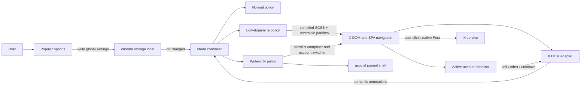

# asocial Extension Architecture

**Status:** Proposed
**Scope:** Private Chrome MVP with a cross-browser path
**Last updated:** 2026-08-13

## 1. Decision summary

Build asocial as a Manifest V3 WebExtension that reshapes X's existing website. Do not build an X client and do not call or intercept X APIs.

Use:

- current stable TypeScript in strict mode;
- WXT as the extension framework and Vite integration;
- React only for the popup and options/onboarding UI;
- framework-free TypeScript in the content-script path;
- SCSS compiled at build time;
- typed SCSS Modules for extension-owned UI through the author's `styletyper` packages;
- non-module SCSS for page-wide startup and X-policy selectors;
- pnpm with an exact `packageManager` version and committed lockfile;
- a deliberately sparse pnpm workspace and Turborepo root;
- Chrome local extension storage;
- Vitest for pure behavior/adapter contracts and browser smoke checks for the actual extension.

Permanent exclusions:

- no backend;
- no telemetry, analytics, tracking pixels, usage counters, or remote configuration;
- no X API credentials, private endpoint calls, or request interception;
- no storage or logging of post text, handles, credentials, or browsing history;
- no background service worker until a concrete feature proves it necessary;
- no state-management library;
- no remotely hosted code;
- no invented shared packages with one consumer.

The central architectural boundary is an **X DOM adapter**. Modes consume semantic surface annotations produced by that adapter; they do not contain scattered X selectors.

## 2. Why a browser extension

The required behavior is presentation control over an authenticated website:

- hide or quiet selected X surfaces;
- preserve X's own composer and action controls;
- react to X's client-side navigation;
- keep authentication and posting inside X;
- restore the original page immediately.

A content script is the smallest mechanism that can do this. Chrome statically declared CSS is injected before DOM construction/rendering, and a `document_start` content script can apply mode state while the document is still loading. Extension contexts can use `chrome.storage` to persist and observe settings.

This architecture does not bypass X authentication, scrape content, or recreate X data. It changes what the user sees in their own browser. That is technically feasible; public distribution still requires a fresh review of X terms and browser-store policy.

## 3. Stack decisions

### 3.1 WXT over hand-rolled Vite entries

WXT is built for WebExtensions, uses Vite, supports TypeScript and SCSS, generates manifests from entrypoints, and targets Chrome, Firefox, Edge, and Safari from one codebase. It removes custom build plumbing for popup pages, content scripts, styles, manifests, development reload, packaging, and store submission.

A custom Vite multi-entry build is possible, but it would make asocial own extension-specific development and release behavior without product benefit. CRXJS is also viable; WXT's cross-browser target and release tooling fit the planned path better.

Use explicit imports. Do not lean on optional auto-import magic where a normal TypeScript import is clearer.

### 3.2 React only where there is application UI

React is limited to four components:

1. `Popup`
2. `Options`
3. `ModePicker`
4. `SettingsForm`

Two additional TSX files are mount-only entrypoints: `popup/main.tsx` and `options/main.tsx`. The initial design therefore has exactly **six TSX files**, of which **four are React components**.

The content script is latency- and mutation-sensitive. It uses DOM APIs, a small controller, and compiled policy styles directly. The journal shell remains vanilla TypeScript in a Shadow Root. Do not mount React over X or represent X content in React state.

### 3.3 SCSS, CSS Modules, and styletyper

`bootstrap.css` in the first draft was not the Bootstrap framework. It meant a tiny custom first-paint safety stylesheet. Rename it to **`startup-mask.scss`** so its purpose is unambiguous.

Use two styling boundaries:

- **Global non-module SCSS:** `startup-mask.scss`, `x-policies.scss`, and `journal-shell.scss`. The first two intentionally target `html[data-asocial-*]`, extension-owned DOM annotations, and stable X surface boundaries. The journal stylesheet is injected as text into a Shadow Root, so a hashed class map would provide no useful boundary.
- **Typed SCSS Modules:** popup, options, and shared React controls. These styles belong to React elements asocial creates, so imported class maps are the correct boundary.

For a Vite application, install **only** `vite-plugin-styletyper`; it already depends on and uses the `styletyper` engine. Do not add `styletyper` as a second direct dependency. Install the SCSS implementation separately for Vite:

```sh
pnpm add -D vite-plugin-styletyper sass-embedded
```

Configure `vite-plugin-styletyper` through WXT's Vite configuration. During development it scans all modules and watches changes. During production it verifies that every module produced both generated files and fails an otherwise-successful build if generation is incomplete; imported CSS errors remain Vite's responsibility and retain Vite's richer diagnostics.

Generated `*.module.*.d.ts` and `*.module.*.d.ts.map` files are compile-time artifacts and stay gitignored. The packaged extension contains only compiled CSS and JavaScript; the plugin and engine add no runtime code.

A clean checkout must run the production WXT build before standalone `tsc`, because `tsc` does not start Vite. No app-owned assertion script or second `styletyper` dependency is needed: missing declaration output is a plugin build failure, while the subsequent `tsc --noEmit` checks class usage against the generated declarations.

WXT orchestrates multiple Vite builds for extension entrypoint groups. Integration tests must prove repeated or concurrent plugin scans are idempotent and race-free. If that fails, fix the plugin/WXT integration rather than adding a consumer-side generator or assertion workaround.

Initial style inventory:

| Style                       | Kind                                                           | Importer                 |
| --------------------------- | -------------------------------------------------------------- | ------------------------ |
| `popup.module.scss`         | typed module                                                   | `Popup.tsx`              |
| `options.module.scss`       | typed module                                                   | `Options.tsx`            |
| `mode-picker.module.scss`   | typed module                                                   | `ModePicker.tsx`         |
| `settings-form.module.scss` | typed module                                                   | `SettingsForm.tsx`       |
| `journal-shell.scss`        | global class names, injected only into the journal Shadow Root | `journal-shell/mount.ts` |
| `startup-mask.scss`         | global static content style                                    | `entrypoints/content.ts` |
| `x-policies.scss`           | global content policy style                                    | `entrypoints/content.ts` |

That is **four SCSS Modules plus three non-module SCSS files**. Exactly **six source files import styles**; `content.ts` imports both page-level global files. Do not split styles further until a component or loading boundary requires it.

### 3.4 pnpm workspace and Turborepo

The requested workspace/Turbo stack remains, but with one application package Turbo gives no material performance benefit yet.

The initial workspace contains only `apps/extension`. Add a package only when a second real consumer exists. Likely future consumers are a public website, a reusable browser-agnostic behavior package, or a separately built Safari host—not hypothetical “shared,” “ui,” and “config” packages.

Use current stable package versions once during scaffolding, then commit exact tool versions and `pnpm-lock.yaml`. “Latest” is an initialization policy, not a runtime dependency range.

## 4. Repository shape

```text
asocial/
├── .github/
│   └── workflows/
│       ├── ci.yml
│       └── release.yml
├── apps/
│   └── extension/
│       ├── entrypoints/
│       │   ├── content.ts
│       │   ├── popup/
│       │   │   ├── index.html
│       │   │   ├── main.tsx
│       │   │   ├── Popup.tsx
│       │   │   └── popup.module.scss
│       │   └── options/
│       │       ├── index.html
│       │       ├── main.tsx
│       │       ├── Options.tsx
│       │       └── options.module.scss
│       ├── src/
│       │   ├── settings/
│       │   │   ├── model.ts
│       │   │   ├── normalize.ts
│       │   │   └── repository.ts
│       │   ├── runtime/
│       │   │   ├── startup.ts
│       │   │   ├── mode-controller.ts
│       │   │   ├── mutation-batcher.ts
│       │   │   └── patch-ledger.ts
│       │   ├── modes/
│       │   │   ├── low-dopamine.ts
│       │   │   ├── normal.ts
│       │   │   └── write-only.ts
│       │   ├── x-adapter/
│       │   │   ├── active-account.ts
│       │   │   ├── adapter.ts
│       │   │   ├── ownership.ts
│       │   │   ├── routes.ts
│       │   │   ├── rules.ts
│       │   │   └── surfaces.ts
│       │   ├── journal-shell/
│       │   │   ├── mount.ts
│       │   │   └── journal-shell.scss
│       │   └── ui/
│       │       ├── ModePicker.tsx
│       │       ├── mode-picker.module.scss
│       │       ├── SettingsForm.tsx
│       │       └── settings-form.module.scss
│       ├── styles/
│       │   ├── startup-mask.scss
│       │   └── x-policies.scss
│       ├── tests/
│       │   ├── fixtures/
│       │   ├── active-account.test.ts
│       │   ├── adapter.test.ts
│       │   ├── mode-controller.test.ts
│       │   └── settings.test.ts
│       ├── package.json
│       ├── tsconfig.json
│       └── wxt.config.ts
├── docs/
│   ├── ARCHITECTURE.md
│   └── PRD.md
├── package.json
├── pnpm-lock.yaml
├── pnpm-workspace.yaml
└── turbo.json
```

This is a target layout, not a requirement to create empty files or packages before implementation.

## 5. Runtime context



There is no asocial server in this flow. The extension never receives X credentials, stores an account handle, or constructs a post request.

## 6. Manifest and permissions

Baseline Manifest V3 capabilities:

```json
{
  "permissions": ["storage"],
  "content_scripts": [
    {
      "matches": ["https://x.com/*", "https://twitter.com/*"],
      "run_at": "document_start",
      "world": "ISOLATED",
      "css": ["startup-mask.css", "x-policies.css"],
      "js": ["content.js"]
    }
  ],
  "action": { "default_popup": "popup.html" },
  "options_ui": { "page": "options.html", "open_in_tab": true }
}
```

WXT compiles the SCSS and generates the final manifest; the snippet documents the production output.

Do not request:

- `cookies`;
- `webRequest` or `declarativeNetRequest`;
- `notifications`;
- broad `tabs` access;
- `scripting` for dynamic arbitrary-site injection;
- `<all_urls>`;
- externally connectable messaging.

If popup-to-tab diagnostics need `activeTab`, first prove the existing X host grant and normal tab messaging are insufficient. Permissions follow implemented behavior, not anticipated behavior. CI inspects the built manifest against this allowlist.

## 7. Settings model

Keep one versioned global object and normalize every read from storage. Account identity is runtime state, not a setting.

```ts
type Mode = "normal" | "low-dopamine" | "write-only";
type MetricScope = "self" | "all";
type AttentionLevel = "normal" | "quiet" | "hidden";

type SettingsV1 = {
  schemaVersion: 1;
  mode: Mode;
  metricScope: MetricScope;
  notificationBadges: AttentionLevel;
  messageBadges: AttentionLevel;
  mentionsShortcut: boolean;
  hideTrends: boolean;
  hideRecommendedPosts: boolean;
  hideAccountSuggestions: boolean;
  hidePremiumAndAnalytics: boolean;
};
```

Defaults:

```ts
const defaults: SettingsV1 = {
  schemaVersion: 1,
  mode: "normal",
  metricScope: "self",
  notificationBadges: "quiet",
  messageBadges: "quiet",
  mentionsShortcut: true,
  hideTrends: true,
  hideRecommendedPosts: false,
  hideAccountSuggestions: false,
  hidePremiumAndAnalytics: true,
};
```

Normalization rules:

- Treat storage as `unknown`; validate enum values and object shapes.
- Do not throw on an older or damaged settings object.
- Keep migrations pure and covered by fixture tests.
- Store only this object in `chrome.storage.local`, not X page storage or Chrome sync.
- Persist mode before applying a user-requested transition.
- Do not add per-handle or per-account settings.
- Do not persist the automatically detected handle, even temporarily.

## 8. Startup and no-flash strategy

`startup-mask.scss` is a custom safety stylesheet, not Bootstrap. Its only job is to prevent X from painting before asocial has resolved the persisted mode.

### Sequence

1. WXT compiles `startup-mask.scss` to a statically declared content stylesheet. The built manifest must list the compiled file in `content_scripts[].css` with `run_at: "document_start"`.
2. The static stylesheet masks X **without requiring a JavaScript-added marker**.
3. At `document_start`, the first content-script statements schedule a recovery-shell timeout and read normalized global settings from `chrome.storage.local`.
4. Apply the stored mode:
   - Normal: prepare no policy or observer.
   - Low-dopamine: classify active identity and required existing surfaces, then apply policy.
   - Write-only: mount the journal shell and install the default-deny structural policy.
5. Set `data-asocial-startup="ready"` only after the selected mode's first safe state is complete.
6. Cancel the recovery timeout.

Conceptual SCSS:

```scss
html:not([data-asocial-startup="ready"]) body > :not(#asocial-root) {
  visibility: hidden !important;
}

#asocial-root {
  visibility: visible !important;
}
```

The absence of `ready` is the safe state. If JavaScript is delayed, X remains masked. If storage or startup fails, the timeout mounts an asocial-owned recovery shell while X remains masked. The shell and toolbar popup show a degraded-state message, expose selector/self-test status, and provide a deliberate Normal-mode escape. Disabling the extension always removes its static styles.

The term **Write-only** describes the X user experience, not storage semantics. `chrome.storage.local` is intentionally read/write: mode changes are written, and the mode is read on every X document start. It persists Write-only across tab closure, browser restart, and extension update.

The initial `visibility` curtain is the same default-deny mechanism used by Write-only. Hidden X roots retain no paint, pointer access, or accessibility exposure; explicitly allowlisted native dialogs override `visibility` and pointer handling without requiring brittle ancestor rewrites. The fixed journal shell covers retained layout.

Test the built unpacked extension—not a source approximation—with cache disabled and CPU/network throttling. Cover cold tab open, browser restart, extension update, slow storage, and injected startup failure using Chrome navigation filmstrips. “No flash” is a measured release invariant.

## 9. Mode controller

`ModeController` is the only owner of active behavior. It receives normalized settings and performs an explicit transition:

1. persist a user-requested mode;
2. stop the previous mode;
3. disconnect its observer;
4. restore reversible attribute patches;
5. remove asocial annotations and shell UI;
6. apply the next mode's first safe state;
7. start only the observer needed by that mode.

### Normal

- No mutation observer.
- No route guard.
- No asocial mode attribute that affects page presentation.
- A storage listener remains so another mode can be activated.

### Low-dopamine

- Derive active-account state from redundant live DOM signals.
- Run adapter annotation on the existing root once.
- Set the effective policy as document attributes.
- Start the mutation batcher for incremental changes.
- Clear identity to `unknown` immediately when either account signal changes.
- Reclassify only after both signals agree again.

### Write-only

- Set the default-deny page mask before processing X content.
- Mount the journal shell in an extension-owned Shadow Root.
- Do not scan or annotate timeline posts.
- Observe only route, native composer, self-thread continuation, authentication, and account-switcher boundaries.
- Mark only complete allowlisted subtrees as visible.
- Keep all other X content absent from layout, paint, pointer input, and the accessibility tree.
- When a composer closes, remove its allowlist annotation and retain the shell and Write-only mode.

The controller is idempotent. Applying the same settings twice must not duplicate observers, roots, styles, or annotations.

## 10. X DOM adapter

X is an unversioned external UI. Treat it like an unstable vendor adapter.

### Responsibilities

- detect route class without importing X internals;
- derive the active account from redundant current-page signals;
- detect supported surfaces in a supplied subtree;
- identify post/profile ownership without persistent identity storage;
- distinguish metric value nodes from their action containers;
- identify the native composer, self-thread continuation, and required descendants;
- identify the native account-switcher button and its portal menu;
- annotate matched elements with asocial-owned `data-asocial-*` attributes;
- report rule IDs and signal agreement without reporting handles or content.

### Selector priority

1. X `data-testid` values with observed semantic stability.
2. Native roles and structural relationships.
3. Exact route/link shapes such as `/{handle}/status/{id}`.
4. Stable input properties.
5. Localized accessible labels only behind a locale-specific adapter.

Never depend on generated class names, React fiber internals, bundled source, cookies, or X's private network operations.

The initial adapter is validated against X in English. Rules that rely on visible or accessible text must declare their locale. Language-independent attributes are preferred so localization can expand without forking mode logic.

### Active-account detection

`ActiveAccountDetector` derives an in-memory normalized handle from two independent DOM surfaces:

1. the native profile-navigation link's `href`;
2. the account identity exposed inside the native `data-testid="SideNav_AccountSwitcher_Button"` surface.

Neither signal is a contractual X API, so both remain adapter rules with fixtures and live release checks. The detector never reads cookies, local storage, page JavaScript state, or network responses.

State machine:

- both signals agree: `known(handle)`;
- either signal changes, is absent, or disagrees: `unknown`;
- after an account switch, require agreement on the new handle before returning to `known`.

The handle exists only in content-script memory for equality comparison. Do not put it in extension storage, messages, diagnostics, or logs.

### Surface vocabulary

Use a closed union rather than arbitrary selector strings in modes:

```ts
type Surface =
  | "post"
  | "profile-relationship-link"
  | "reply-metric"
  | "repost-metric"
  | "like-metric"
  | "bookmark-metric"
  | "view-metric"
  | "analytics-entry"
  | "notifications-nav"
  | "notifications-badge"
  | "mentions-nav"
  | "messages-nav"
  | "messages-badge"
  | "trend"
  | "recommended-post"
  | "account-suggestion"
  | "premium-prompt"
  | "composer"
  | "self-thread-context"
  | "account-switcher-button"
  | "account-switcher-menu";
```

Modes depend on this vocabulary. Only adapter rules know how a surface maps to current X markup.

### Ownership classification

For each post/profile:

1. locate the semantic author/profile link;
2. parse and normalize its first path segment;
3. reject reserved X paths such as `home`, `explore`, `notifications`, `messages`, `i`, and `compose`;
4. compare case-insensitively with the detector's current `known(handle)`;
5. return `self`, `other`, or `unknown`.

Policy:

- `self` + self scope: hide metric values;
- `other` + self scope: preserve metric values;
- any owner + all scope: hide metric values;
- `unknown` + self scope: hide metric values, preserve action containers.

This asymmetry favors the product goal without disabling interaction.

## 11. Mutation and navigation handling

X is a single-page application. Initial annotation is insufficient.

Use one `MutationObserver` per active restrictive mode:

- observe `childList` and `subtree`;
- add only changed roots to a `Set<Node>`;
- batch processing into one microtask or animation frame;
- collapse descendant roots when an ancestor is already queued;
- run adapter rules only inside queued roots;
- compare `location.pathname` once per batch to detect route changes;
- listen to `popstate` as an additional signal;
- use the browser Navigation API only as an optional progressive enhancement.
- Re-run active-account signals whenever their observed link/button nodes or relevant attributes change, including account-switch SPA transitions.

Do not monkey-patch `history.pushState` in X's main JavaScript world. A normal route change produces DOM mutations; route comparison during those batches avoids page-world injection.

Observe only the attributes required by a proven rule. Avoid a global unfiltered attribute observer and avoid timers that rescan the document.

## 12. Hiding metrics without removing actions

CSS must target an annotated metric value, not the surrounding button.

Conceptual markup after annotation:

```html
<button data-testid="like" data-asocial-action="like">
  <svg><!-- icon --></svg>
  <span data-asocial-metric="like">12</span>
</button>
```

Conceptual policy CSS:

```css
html[data-asocial-mode="low-dopamine"] [data-asocial-owner="self"] [data-asocial-metric] {
  display: none !important;
}
```

The actual X markup may require annotating an intermediate wrapper. The invariant is stable: the metric node can disappear while the button remains.

If X places a count in an action's `aria-label`, visually hiding a child span is insufficient. The adapter must set a count-free accessible action name and record the original attribute in a `PatchLedger`. On transition to Normal or element reclassification, restore the original value exactly. Attribute changes from X must update the patch safely; never leave a stale “Like” label on an “Unlike” action.

The live-DOM implementation spike must inspect this behavior before declaring accessibility acceptance complete.

## 13. Write-only shell and native-control allowlist

Write-only is persistent and default-deny.

### Shell

- Add one fixed `#asocial-root` sibling under `body`.
- Attach a Shadow Root so X styles cannot accidentally restyle the shell.
- Inject `journal-shell.scss` as text inside that Shadow Root; use stable local class names because X cannot address through the shadow boundary.
- Include product name, “Write on X,” the audience reminder, in-memory active-account status, and a recovery link that opens extension settings.
- Keep mode switching in the extension toolbar/options surface; do not imitate X navigation.

### Page mask

The startup mask initially hides the page before classification. Once Write-only is known, structurally remove all X roots except complete allowlisted surfaces. The final state must remove disallowed content from layout, paint, pointer input, and the accessibility tree.

Do not build an asocial text area and copy its content into X. That creates draft custody, synchronization, and accidental-posting risks.

### Opening and completing the composer

“Write on X” is an explicit user action. It may navigate the current X tab to X's published `/compose/post` route. X remains responsible for rendering, validation, media, audience controls, native multi-post thread controls, and submission.

A composer rule must match at least:

- editable input;
- native submit button;
- enclosing dialog/region;
- close/cancel path.

If the complete contract is not met, reveal none of the candidate subtree. Show “X's composer could not be identified; switch to Normal to continue.”

Detect composer closure by removal of the allowlisted root, not by inspecting the network request or post text. Posting, cancellation, and native multi-post completion all return to the journal shell with Write-only still persisted.

### Self-thread continuation

Support X's native multi-post composer first. A post-submit reply-to-self flow is allowed only when:

- active-account signals agree;
- the parent post is classified `self`;
- only the minimum self-authored parent context and native reply composer can be isolated;
- no surrounding conversation or metrics are exposed.

If any invariant fails, keep the route masked. Do not broaden the allowlist or inspect a private API to recover the flow.

### Native account switching

Allowlist the current X `SideNav_AccountSwitcher_Button` and the portal menu opened by a direct user action on that button.

The menu contract requires:

- a menu/dialog root attributable to that click;
- native account choices and add/manage-account actions only;
- unread counts/badges and unrelated navigation hidden;
- lifetime tied to the native menu's open state.

On selection, immediately clear active identity to `unknown`, keep all metrics hidden, and wait for profile-nav and account-switcher signals to agree on the new handle. Settings and Write-only remain global and unchanged.

If the button or menu cannot be isolated safely after an X change, expose neither and retain a Normal-mode escape.

### Authentication and recovery

Authentication is not a reading surface, but it is also not part of the composer contract. Recognized X login, challenge, and account-recovery routes may use a separate, narrow allowlist after live validation. If a route is unknown, keep X masked and offer a user-initiated switch to Normal; never broaden another allowlist to make login “work.”

### Fetching boundary

asocial can guarantee that reading surfaces are not rendered. It cannot guarantee X's application will not fetch timeline data. Blocking private requests would require broader permissions and a brittle dependency on X internals; do not implement it.

## 14. UI surfaces

### Popup

`Popup.tsx` composes:

- `ModePicker`;
- effective current mode;
- “Write on X” action in write-only;
- active-account signal status (`known`/`unknown`) without displaying or persisting the handle;
- link to detailed settings;
- user-visible degraded-state warning and selector self-test when required rules fail.

### Options/onboarding

`Options.tsx` composes `SettingsForm` and includes:

- plain-language explanation of modes;
- explicit public-audience warning;
- low-dopamine settings;
- independently removable Mentions shortcut;
- independent trend, recommended-post, and account-suggestion toggles;
- local selector self-test, diagnostics, copy-safe rule report, and reset;
- no handle field, account login, cloud account, telemetry consent, or analytics preference.

Use native form elements where possible. No design-system dependency is needed.

### React and style count

- Six TSX files total.
- Four React components.
- Four typed SCSS Modules.
- Three non-module SCSS files, including the Shadow Root journal stylesheet.
- Six source files import styles.
- Zero React roots in the X content path.

## 15. Messaging and diagnostics

Most state propagation needs no background worker:

- popup/options write global settings to `chrome.storage.local`;
- every X content script listens to `chrome.storage.onChanged`;
- open tabs apply the new settings directly;
- browser restart reloads the persisted mode before revealing X.

For diagnostics, the popup sends a one-shot message to the active X content script:

```ts
type RuntimeStatus = {
  mode: Mode;
  adapter: "inactive" | "ready" | "degraded";
  route: "auth" | "compose" | "status" | "reading";
};
```

The recovery shell and popup surface degraded status locally. The response contains no DOM text, handles, URLs, account IDs, post identifiers, or browsing history.

Add a background service worker only if a later requirement cannot be met by popup/options/content contexts—for example, a browser command that must work with no X tab loaded. Release automation is external CI and does not justify runtime background code.

## 16. Security and privacy model

### Trust boundaries

- X DOM is untrusted input.
- Extension settings are untrusted persisted JSON until normalized.
- X remains the only party handling X credentials and publishing.
- asocial UI never treats DOM text as HTML or executable data.
- GitHub Actions and browser-store credentials exist only in protected release infrastructure, never in the extension.

### Controls

- Run content code in Chrome's isolated world.
- Render shell strings with DOM text nodes/React escaping, never `innerHTML` from X.
- Keep all executable code in the extension package.
- Use no `eval`, remote scripts, analytics SDKs, telemetry, tracking pixels, or remote configuration.
- Use no network request APIs in product code.
- Store only normalized global settings locally.
- Keep detected handles in content-script memory only and omit them from messages/logs.
- Restore every patched X attribute on Normal transition.
- Avoid logging content or identifiers in development helpers and tests.
- Inspect built permissions and remote-code absence in CI.
- Publish through a protected GitHub environment with manual approval and least-privilege store secrets.

A public Chrome Web Store release still needs an accurate privacy policy and disclosures because the extension can read and change an X page, even though it transmits nothing.

## 17. Testing strategy

### Pure unit tests

- settings defaults, normalization, corruption handling, and migrations;
- active-account agreement, disagreement, switch transition, and non-persistence;
- reserved-path rejection and ownership policy matrix;
- mode-controller idempotence and cleanup;
- mutation queue deduplication;
- patch-ledger exact restoration.

### Style pipeline tests

- start WXT development from a clean checkout and prove all SCSS Module declarations appear;
- run a production WXT build before standalone TypeScript and prove the plugin rejects a broken unimported module;
- prove every SCSS Module class reference type-checks with generated declarations;
- verify repeated/concurrent WXT entrypoint builds are idempotent and race-free;
- verify generated declarations/maps are untracked and absent from the package;
- verify `startup-mask.scss` and `x-policies.scss` compile to manifest-declared static CSS;
- verify journal-shell styles are injected inside its Shadow Root.

### DOM adapter contract tests

Maintain small, sanitized HTML fixtures representing only required X structure. No real post text, handles, profile data, cookies, or captured page dumps.

For every supported context, assert both halves:

- forbidden count/surface is hidden or annotated;
- required action/link remains present and operable.

Contexts:

- agreeing and disagreeing active-account signals;
- account switch transition;
- own and other post in timeline;
- own and other profile;
- focused own and other post;
- quote post and repost menu;
- notification/message navigation and badges;
- native composer, native multi-post, media, and error state;
- supported and rejected self-thread continuation;
- native account-switcher button/menu and changed markup;
- unknown ownership;
- markup with one required selector missing.

### Browser extension tests

Run a built unpacked extension in Chromium against synthetic pages to verify:

- manifest and static style injection;
- cold-start, reopen, restart, slow-storage, and extension-update masking;
- startup failure produces a recovery shell without revealing X;
- cross-context storage propagation;
- popup/options state;
- exact Normal cleanup;
- Shadow Root shell isolation;
- no extension-originated network requests;
- no timeline-post annotation in Write-only;
- built permission allowlist.

### Authenticated manual release matrix

Do not put X credentials in CI. Before a release, manually exercise current X in Chrome and Brave with a dedicated test account:

- home/Following/For You;
- own profile and another profile;
- own post and another post;
- compose text, media, cancel, and native multi-post thread;
- supported self-thread continuation;
- quote/repost control;
- Notifications, Mentions, and Messages;
- search/direct reading routes in write-only;
- native account switching in Write-only;
- tab close/reopen and full Chrome restart while Write-only is persisted;
- light/dim/dark themes;
- narrow and wide desktop viewport.

Record rule health, performance traces, and navigation filmstrips without user content or handles. A selector fixture is updated only after the new live behavior is understood.

## 18. Build and release

### Workspace tasks

Root Turbo tasks forward only real package tasks:

- `dev` — persistent WXT development task with `vite-plugin-styletyper`;
- `build` — reproducible WXT build; generation is a hard plugin-owned precondition;
- `check` — run `build`, then standalone TypeScript and focused static checks;
- `test` — deterministic unit and adapter contracts;
- `zip` — package the verified WXT output;
- `submit` — protected WXT store submission, never a normal local default.

Do not run the persistent `dev` task through a normal finite CI command.

### Continuous integration

Every pull request and main-branch push runs:

1. checkout without persisted credentials;
2. exact Node/Corepack/pnpm toolchain setup;
3. `pnpm install --frozen-lockfile`;
4. production WXT build, which runs `vite-plugin-styletyper`;
5. assert generated per-module declarations/maps exist;
6. TypeScript/static checks and deterministic tests;
7. built-manifest permission/host allowlist inspection;
8. package scan for remote code, analytics endpoints, and generated style declarations.

Fork pull requests receive no release secrets.

### Release workflow

The first Chrome Web Store listing and consent setup are manual. Subsequent updates use a protected tag/manual-dispatch workflow:

1. require version, tag, and changelog consistency;
2. repeat the frozen CI pipeline;
3. create WXT ZIP artifacts;
4. produce SHA-256 checksums;
5. create a GitHub Release;
6. wait for approval on a protected production environment;
7. submit the Chrome update with WXT using least-privilege protected secrets;
8. record the store submission result without publishing credentials or user data.

Do not auto-submit every merge to `main`.

Brave installs and updates Chrome Web Store extensions. There is no separate Brave Extension Store deployment; validate the Chrome package in Brave and document compatibility.

Before store publication:

- re-check Chrome Web Store policies and X terms;
- inspect the generated manifest and permission warnings;
- add the required privacy policy and store disclosures;
- remove development-only permissions and logs;
- perform clean-profile Chrome and Brave install tests.

## 19. Safari/iOS path

A native iOS X client is not required. Safari supports WebExtensions on Apple platforms, and Apple provides a conversion/packaging path for existing web extensions.

Preserve that option now by:

- using WebExtension-compatible storage and messaging;
- keeping browser-specific calls behind tiny adapters;
- avoiding persistent background assumptions;
- keeping X behavior separate from Chrome packaging;
- testing touch/narrow layout only after the desktop contract is stable.

A later Safari milestone still requires Apple packaging, permissions, App Store review, and real iPhone validation. It is a separate distribution project, not proof that every Chrome DOM behavior will work unchanged on mobile X.

## 20. Alternatives considered

### Standalone X client

Rejected. It requires API access, authentication, content rendering, and ongoing platform permission. It also expands the product from attention control into a full client.

### Extension-owned composer calling X endpoints

Rejected. It would require API access or unsupported/private requests and would take custody of post content. X's native composer already solves authentication, media, validation, and audience controls.

### User stylesheet only

Rejected. CSS can hide broad static surfaces, but cannot reliably identify the active account, classify ownership, respond to settings, restore attributes, or safely allowlist a dynamic composer.

### Main-world script injection

Rejected for MVP. Isolated content scripts can observe and annotate the DOM. Main-world code increases interference and trust risk without a proven need.

### One giant React content application

Rejected. React does not own X's DOM and should not mirror it. A direct adapter and static policy CSS are smaller and less error-prone.

### No workspace/Turbo

Technically preferable for one package, but not selected because the requested project stack includes pnpm workspaces/Turbo and a second platform is plausible. The architecture limits the cost by refusing speculative packages.

## 21. Implementation order

1. Scaffold the sparse pnpm/Turbo/WXT repository and pin the toolchain.
2. Integrate `sass-embedded` and `vite-plugin-styletyper` only; prove clean-checkout WXT generation, declaration assertions, standalone type-checking, concurrent entrypoint safety, and production CSS output.
3. Implement global settings normalization/repository and the three-mode popup.
4. Implement the static startup mask, fail-closed recovery shell, mode controller, cleanup, and cross-tab/restart propagation against synthetic pages.
5. Spike current live X active-account and account-switcher DOM surfaces; document the smallest semantic contracts.
6. Implement low-dopamine identity/ownership and metric annotations; prove controls remain operable.
7. Implement independent notification, message, Mentions, trend, recommended-post, account-suggestion, and prompt rules.
8. Implement the persistent Write-only shell, strict native-composer allowlist, native multi-post flow, and account-switcher allowlist.
9. Add self-thread continuation only after its minimal context can be isolated safely.
10. Run the authenticated route/performance matrix and repair selector, accessibility, and flash gaps.
11. Package a private Chrome/Brave build.
12. Add protected CI/release automation after the first manual store listing exists.

Do not begin with every selector. Prove the vertical slice first: persisted mode → static startup mask → automatic active identity → one own-post metric hidden → Normal restores it exactly.

## 22. Sources

- Chrome, [Manifest content scripts](https://developer.chrome.com/docs/extensions/reference/manifest/content-scripts.md.txt): static style ordering, match patterns, `document_start`, and isolated worlds.
- Chrome, [`chrome.storage`](https://developer.chrome.com/docs/extensions/reference/api/storage): extension-local persistence and change events available to content scripts.
- Chrome Web Store, [Program Policies](https://developer.chrome.com/docs/webstore/program-policies/policies): narrow permissions, limited use, disclosure, and remotely hosted code constraints.
- WXT, [official overview](https://wxt.dev/): Vite-based extension development, TypeScript, generated manifests, and cross-browser targets.
- WXT, [Content scripts](https://wxt.dev/guide/essentials/content-scripts.html): content-script style handling and UI injection.
- WXT, [Publishing](https://wxt.dev/guide/essentials/publishing.html): ZIP generation, store submission, and GitHub Actions release path.
- [`cryptofelon/styletyper`](https://github.com/cryptofelon/styletyper): typed CSS/SCSS Modules, Vite plugin, CLI, generated declaration maps, and compile-time-only output.
- Brave, [installing extensions](https://support.brave.com/hc/en-us/articles/360017909112-How-can-I-add-extensions-to-Brave): Chrome Web Store compatibility.
- Apple, [Safari Extensions](https://developer.apple.com/safari/extensions/): conversion and packaging path for WebExtensions on Apple platforms.
- X, [Terms of Service](https://x.com/en/tos): re-check before any public distribution.
- [Control Panel for Twitter](https://soitis.dev/control-panel-for-twitter): an existing cross-browser extension demonstrates that user-controlled X presentation and a later Safari/iOS distribution path are practical. It is feasibility evidence, not a code dependency.
